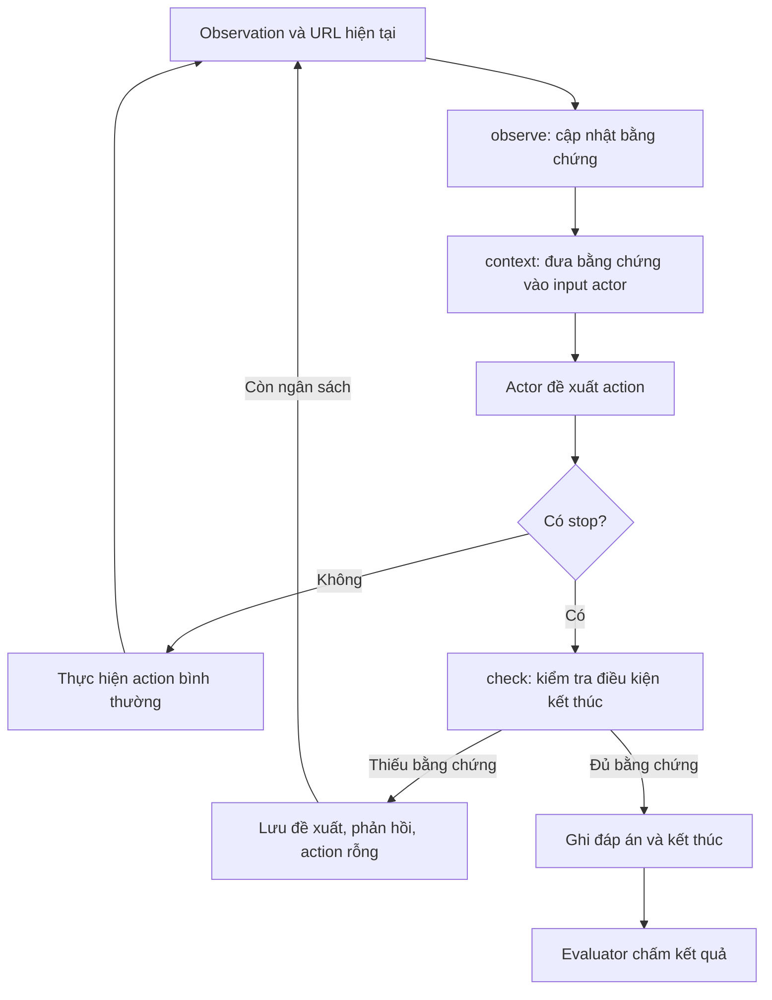

# Tổng hợp thay đổi AgentOccam: kiểm tra bằng chứng trước khi dừng

Cập nhật theo mã nguồn và kiểm thử ngày **06/11/2026**.

Tài liệu này giải thích các phần đã thêm hoặc sửa trong quá trình xử lý lỗi
*premature stopping*, bổ sung ba phiên bản thí nghiệm và sửa lỗi trình duyệt phát
sinh khi chạy. Các đường dẫn trong tài liệu tính từ thư mục `AgentOccam/docs/`.

## 1. Vấn đề và hành vi sau cải tiến

Vấn đề ban đầu: model không thấy đơn phù hợp trên trang đang xem, rồi kết luận
không có đơn trong toàn bộ lịch sử. Ví dụ, mới đọc 10/37 đơn nhưng trả lời tổng
chi tiêu bằng `$0` dù các trang chưa xem có thể thay đổi kết quả.

Cơ chế mới có ba phần:

| Thành phần | Công việc |
| --- | --- |
| Theo dõi bằng chứng | Ghi lại những đơn thực sự đã quan sát, vị trí của chúng và phạm vi đã đọc |
| Xác định điều kiện kết thúc | Phân biệt tìm một đơn, tìm N đơn, đếm/tính tổng, liệt kê toàn bộ, tra cứu và so sánh |
| Kiểm tra trước `stop` | Cho phép dừng khi đủ bằng chứng; nếu thiếu thì trả phản hồi cho actor để tiếp tục |

Mục tiêu là dừng khi **đủ bằng chứng cho yêu cầu**. Với câu hỏi có/không, một đơn
phù hợp có thể đủ để trả lời Có. Với câu hỏi tính tổng, cần bao phủ phạm vi liên
quan; phạm vi này có thể chỉ là một khoảng ngày, không nhất thiết toàn bộ lịch sử.

Guard không gọi thêm LLM và không lấy đáp án chuẩn hoặc reward làm bằng chứng.
Nó cũng chưa kiểm chứng toàn bộ phép tính và mọi phát biểu trong đáp án của model.

## 2. Các file đã thêm hoặc sửa

| File | Thay đổi và chức năng |
| --- | --- |
| [stop_guard.py](../AgentOccam/stop_guard.py) | Thêm bộ nhớ bằng chứng, kiểm tra phạm vi, điều kiện dừng sớm và phản hồi thiếu bằng chứng |
| [stop_requirements.py](../AgentOccam/stop_requirements.py) | Thêm parser loại yêu cầu, số kết quả, trạng thái, khoảng ngày tuyệt đối và tương đối |
| [stop_policy.py](../AgentOccam/stop_policy.py) | Thêm ba mode và hướng dẫn chung về bằng chứng cho Prompt-only/Evidence-gated |
| [AgentOccam.py](../AgentOccam/AgentOccam.py) | Tích hợp guard vào vòng lặp, bổ sung context cho actor, chặn trước khi finalize action, ghi quyết định vào log |
| [env.py](../AgentOccam/env.py) | Đọc metadata sắp xếp, phục hồi observation sau lỗi và kết thúc ngay khi nhận `stop` |
| [browser_env/processors.py](../browser_env/processors.py) | Xử lý phản hồi CDP thiếu `value` hoặc bounding box không hợp lệ |
| [browser_env/actions.py](../browser_env/actions.py) | Cho click dùng locator hiện có của Playwright mà không bị chặn trước bởi kiểm tra CDP trên node đã hết hiệu lực |
| [browser_env/envs.py](../browser_env/envs.py) | Thêm `refresh_observation()` để đọc lại trạng thái hiện tại mà không thực hiện lại action |
| [eval_webarena.py](../eval_webarena.py) | Ghi mode/config vào JSON, đưa chỉ số guard vào summary qua status và sửa cách tạo đường dẫn log trên Windows |
| [audit_stop_guard.py](../scripts/audit_stop_guard.py) | Thêm công cụ phát lại observation đã lưu để kiểm tra quyết định của guard, không gọi model/browser |
| [AgentOccam_shopping_qwen.yml](../AgentOccam/configs/AgentOccam_shopping_qwen.yml) | Bổ sung cấu hình guard và quy tắc sắp xếp cho config Shopping hiện có |
| [AgentOccam_shopping_qwen_baseline.yml](../AgentOccam/configs/AgentOccam_shopping_qwen_baseline.yml) | Thêm cấu hình phiên bản Baseline |
| [AgentOccam_shopping_qwen_prompt_only.yml](../AgentOccam/configs/AgentOccam_shopping_qwen_prompt_only.yml) | Thêm cấu hình phiên bản chỉ bổ sung prompt |
| [AgentOccam_shopping_qwen_evidence_gated.yml](../AgentOccam/configs/AgentOccam_shopping_qwen_evidence_gated.yml) | Thêm cấu hình phiên bản có prompt, trạng thái bằng chứng và kiểm tra `stop` |
| [test_stop_guard.py](../tests/test_stop_guard.py) | Kiểm thử coverage, các điều kiện dừng và tích hợp vào agent |
| [test_stop_variants.py](../tests/test_stop_variants.py) | Kiểm thử khác biệt giữa ba mode, prompt chung và tính đồng nhất cấu hình thí nghiệm |
| [test_relative_order_dates.py](../tests/test_relative_order_dates.py) | Kiểm thử ngày tương đối, mốc tham chiếu, nguồn sắp xếp và trường hợp task 47 |
| [test_browser_recovery.py](../tests/test_browser_recovery.py) | Kiểm thử lỗi CDP, phục hồi observation và `stop` không chụp thêm trang |
| [order_history_task47.json](../tests/fixtures/order_history_task47.json) | Dữ liệu tái hiện lỗi gồm objective, URL, bảng đã quan sát và đề xuất `stop`; không chứa đáp án evaluator |
| [README.md](../README.md) và các file trong `docs/` | Bổ sung giải thích, hướng dẫn cấu hình/chạy và ghi nhận nguồn thứ tự ngày |
| [.gitignore của AgentOccam](../.gitignore) | Bổ sung bỏ qua hai file log tạm `play-...evidence_gated.txt` và `trash-...evidence_gated.txt` |

Các screenshot, trajectory và `summary.csv` được sinh ra khi chạy là kết quả
thực nghiệm. Việc chúng xuất hiện trong Git diff không đồng nghĩa chúng là phần
triển khai tính năng.

## 3. `StopGuard` làm gì trong mỗi lượt?

Luồng dưới đây áp dụng cho mode `evidence_gated`:



### `observe(url, observation)`: lưu những gì đã thực sự đọc

Hàm đọc bảng concise `Orders` tại `/sales/order/history/`, lấy mã đơn, ngày,
tổng tiền, trạng thái và thông tin như `Items 1 to 10 of 37 total`.

Mỗi phạm vi được lưu trong một `Coverage`:

| Trường | Vai trò |
| --- | --- |
| `rows` | Các hàng đã đọc, tra theo mã đơn |
| `positions` | Vị trí trong danh sách → mã đơn, để biết có bỏ sót đoạn nào không |
| `total` | Tổng số đơn theo thông tin hiển thị của trang |
| `pages`, `page_count` | Trang đã quan sát và tổng số trang |
| `sort_directions`, `sort_sources` | Thứ tự ngày và nguồn xác minh theo từng vị trí |
| `issue` | Vấn đề dữ liệu như observation bị cắt hoặc số hàng không khớp khoảng hiển thị |

Đọc lại cùng trang không tăng coverage. URL đổi sang `?p=2` hay action đã click
Page 2 cũng không tự chứng minh đã đọc trang 2: phải có observation tương ứng.
Các trang cùng lịch sử được gộp, nhưng các phạm vi có bộ lọc/thứ tự khác nhau
không được trộn. Tổng số bản ghi thay đổi hoặc đơn đổi vị trí sẽ làm mất hiệu lực
coverage cũ. Hàng bị cắt có thể vẫn là bằng chứng về một đơn đã nhìn thấy, nhưng
không đủ để xác nhận đã đọc trọn khoảng item.

Bộ nhớ này thuộc guard, nên không phụ thuộc vào việc actor giữ lại bao nhiêu lượt
trong history. Phản hồi từ chối cũ được xóa khi trạng thái bằng chứng thay đổi.

### `context()`: giải thích bằng chứng hiện có cho actor

Context gồm loại yêu cầu, khoảng ngày, trạng thái cần tìm, phạm vi đã đọc, nguồn
thứ tự ngày, các hàng đã quan sát, mã đơn phù hợp và phản hồi thiếu bằng chứng.
Ví dụ rút gọn:

```text
request type = aggregate
Requested date range: 2023-05-12 to 2023-06-12
status=complete
observed 10/37 orders; pages [1]/4; complete=False
Date sort evidence: magento_history_source ...
Observed matching order IDs: []
```

`complete=False` ở đây nghĩa là **chưa đọc hết lịch sử 37 đơn**. Nó không đồng
nghĩa với `stop` bị cấm: yêu cầu có thể đã được đáp ứng nhờ bao phủ trọn khoảng
ngày hoặc đã tìm đủ số đơn cần thiết. Quyết định nằm ở `check()`.

Context chỉ cung cấp thông tin; nó không tự sinh `stop` hay tự chuyển một action
click thành `stop`. Model vẫn có thể chọn đọc thêm dù đã đủ bằng chứng.

### `check(action)`: quyết định có cho thực thi `stop` không

Hàm không xử lý action thông thường. Với `stop`, nó kiểm tra mode, phạm vi hỗ trợ,
coverage và bằng chứng dừng sớm. Bằng chứng dừng sớm được tìm trong
`early_evidence()`.

| Loại yêu cầu | Điều kiện dừng sớm đã hỗ trợ | `reason` khi đủ bằng chứng |
| --- | --- | --- |
| Có đơn phù hợp không? | Một đơn khớp mọi điều kiện và câu trả lời Có phù hợp | `matching_witness` |
| Tìm N đơn | Có đủ N mã khác nhau khớp điều kiện; đáp án liệt kê mã đã quan sát | `requested_matches_found` |
| Thuộc tính của mã đơn cụ thể | Đã quan sát đúng mã đơn cần tra cứu | `observed_target_order` |
| Đơn mới nhất/đầu tiên | Đọc liên tục từ đầu danh sách tới đơn phù hợp đầu tiên, với chiều ngày đúng yêu cầu | `ordered_first_match` |
| Đếm/tính tổng, liệt kê toàn bộ hoặc xác nhận không có trong một kỳ | Đã bao phủ trọn khoảng ngày bằng thứ tự đã xác minh | `requested_date_range_covered` |
| Đã đọc đủ toàn bộ phạm vi | Coverage đầy đủ | `full_coverage` |

Truy vấn thuộc phạm vi đơn hàng nhưng parser chưa hiểu đầy đủ sẽ dùng yêu cầu
coverage bảo thủ. Những so sánh khác như giá cao nhất/thấp nhất chưa có điều kiện
dừng sớm theo thứ tự giá. Tác vụ ngoài phạm vi guard được cho đi qua với
`reason=unsupported_task`; điều đó không xác nhận câu trả lời là đúng.

Khi từ chối, guard trả `allowed=false`, `reason=insufficient_evidence` và phản hồi.
Trong `AgentOccam.py`, đề xuất gốc được lưu vào `proposed_action`, còn action thực
thi trở thành chuỗi rỗng. Lượt này vẫn tính vào ngân sách, nhưng không click hay
chụp trang. Guard kiểm tra trước `finalize_action()` để action bị chặn chưa thay
đổi plan hoặc ghi chú. Batch vừa điều hướng vừa `stop` cũng phải chờ quan sát
kết quả điều hướng trước khi kết luận.

## 4. Các ví dụ về điều kiện kết thúc

### Chưa đủ bằng chứng để trả lời bằng 0

```text
Objective: How much did I spend on orders in January 2023?
Đã đọc: trang 1, 10/37 đơn, chỉ thấy đơn tháng 3 và tháng 5.
Đề xuất: stop [$0]
```

Nếu chưa có bằng chứng về thứ tự ngày hoặc chưa đọc qua mốc bắt đầu tháng 1,
guard phải chặn. Các trang sau vẫn có thể chứa đơn tháng 1. Đây là lỗi
premature stopping mà cơ chế ban đầu nhắm tới.

### Tìm đủ ví dụ thì được dừng

```text
Objective: Find 3 pending orders
Đã thấy: 000000101, 000000102, 000000103 đều Pending.
Đề xuất: stop [000000101, 000000102, 000000103]
```

Trong điều kiện trên, guard cho phép dừng dù lịch sử còn nhiều trang. Nếu chỉ
thấy hai mã mà model nêu thêm mã thứ ba chưa quan sát, điều kiện dừng sớm không đạt.

### Khoảng ngày đã đủ dù lịch sử chưa đầy đủ: task 47

```text
Today is 6/12/2023. Tell me how many fulfilled orders I have
over the past month, and the total amount of money I spent.
```

Parser hiểu `6/12/2023` theo quy ước Mỹ là **12/06/2023**. Khoảng cần xét là
**12/05–12/06/2023**, bao gồm hai đầu; `fulfilled` được ánh xạ sang `Complete`.
Câu hỏi đếm đơn và tổng chi tiêu trong cùng kỳ được coi là một phạm vi aggregate.

Trong fixture lịch sử đơn hàng, trang đầu đọc đủ item 1–10 của 37 đơn. Một số
hàng tiêu biểu như sau; bảng dưới chỉ rút gọn để giải thích:

| Mã đơn | Ngày ISO | Trạng thái | Có khớp yêu cầu không? |
| --- | --- | --- | --- |
| 000000170 | 2023-05-17 | Canceled | Không, sai trạng thái |
| 000000189 | 2023-05-02 | Pending | Không, trước kỳ cần xét và sai trạng thái |
| 000000180 | 2023-03-11 | Complete | Không, trước kỳ cần xét |
| 000000157 | 2023-02-09 | Complete | Không, trước kỳ cần xét |

Khi đã xác minh toàn bộ lịch sử sắp ngày giảm dần, phần chưa đọc phía sau các hàng
này không thể bổ sung đơn trong kỳ 12/05–12/06. Guard cho phép:

```json
{
  "allowed": true,
  "reason": "requested_date_range_covered",
  "date_range": ["2023-05-12", "2023-06-12"],
  "matching_order_ids": [],
  "prefix_items": 10
}
```

Đây là kết quả kiểm tra một observation cụ thể, không phải quy tắc cố định
`task_id == 47`. Fixture chỉ phục vụ kiểm thử; guard khi chạy không đọc fixture.

Trong lượt chạy mới hơn, bước 2 lại ở `/customer/account/` với bảng Recent Orders.
Adapter hiện chưa dùng bảng này để chứng minh bao phủ lịch sử, nên vẫn chặn.
Đến trang `/sales/order/history/`, nếu model chọn click Page 2 thì đó là lựa chọn
của model; guard chỉ xét cho phép/từ chối khi nhận được đề xuất `stop`.

## 5. Parser ngày và quy tắc sắp xếp

### `stop_requirements.py`

`parse_requirement()` phân tích objective; `criteria_requirement()` yêu cầu khớp
toàn bộ điều kiện thuộc mẫu hỗ trợ; `date_window()` tính khoảng ngày;
`OrderRequirement.matches()` kiểm tra trạng thái và ngày trên **cùng một hàng**.

Các cách diễn đạt ngày được hỗ trợ trong các mẫu câu parser nhận diện:

| Biểu thức | Cách hiểu |
| --- | --- |
| `in January 2023` | 01/01–31/01/2023 |
| `from 2023-01-01 to 2023-01-31` | Khoảng bao gồm hai đầu |
| `Today is 6/12/2023.` + `over the past month` | 12/05–12/06/2023 |
| `Today is 2023-06-12.` + `in the past two weeks` | 29/05–12/06/2023 |

Ngày dạng số nhận `MM/DD/YY`, `MM/DD/YYYY` hoặc `YYYY-MM-DD`. Khoảng tương đối
nhận `over/in/during the past [N] days/weeks/months/years`, với mốc `Today is DATE.`
từ objective; không dùng ngày của máy tính. Không có N thì dùng 1. Tháng/năm trừ
theo lịch và chặn ở ngày cuối tháng khi cần: 31/03/2024 trừ một tháng là 29/02/2024.

Parser là tập mẫu có giới hạn. Thiếu mốc cho ngày tương đối, ngày không hợp lệ,
điều kiện như `containing food` hay yêu cầu ghép không hỗ trợ sẽ không được bỏ qua
để tạo một điều kiện dừng sớm dễ hơn. Trong phạm vi đơn hàng, guard quay về kiểm
tra coverage đầy đủ.

### `order_history_sort` trong config

```yaml
order_history_sort:
  origin: "http://localhost:7770"
  direction: "descending"
  source: "magento_history_source"
  reference: "shopping_final_0712:Magento/Sales/Block/Order/History.php:sha256=9bc70887666e2fde89d40a7f380835410bd2ec13e68b2f19a8697dea2de9c418"
```

| Trường | Ý nghĩa |
| --- | --- |
| `origin` | Bản cài đặt website mà quy tắc áp dụng |
| `direction` | Thứ tự giảm dần, mới trước/cũ sau |
| `source` | Loại nguồn đã xác minh: mã Magento tạo lịch sử đơn |
| `reference` | File nguồn và hash để truy vết bản đã đọc; không phải mã task hoặc đáp án |

Nguồn đã kiểm tra trong container Shopping gọi `setOrder('created_at', 'desc')`
cho collection lịch sử và dùng collection này với pager. Xem
[ghi nhận xác minh nguồn](shopping_order_sort.md).

Guard ưu tiên metadata DOM `aria-sort` do môi trường đọc. Nếu thiếu metadata này,
nó có thể dùng quy tắc config cho đúng origin, đúng `/sales/order/history/` và
query chỉ gồm phân trang/kích thước trang. Query sort tắt fallback; query filter
chưa hỗ trợ không được tính coverage. Quan sát thực tế vẫn phải có số hàng hợp
lệ, các vị trí liên tục từ item 1 và ngày nhất quán với chiều đã khai báo.

Với chiều giảm dần, phải đọc tới ngày **nhỏ hơn** ngày đầu khoảng; bằng đúng ngày
đầu chưa đủ vì trang tiếp theo có thể còn đơn cùng ngày. Với chiều tăng dần,
phải đọc qua ngày cuối khoảng. Chỉ thấy ngày trên trang đầu có vẻ giảm dần không
đủ để xác minh thứ tự toàn bộ lịch sử.

Hash trong config là thông tin truy vết, không được tự đối chiếu container mỗi
lượt. Khi thay website/image/plugin ảnh hưởng collection, cần xác minh lại hoặc
bỏ quy tắc này. Việc parse ngày vẫn hoạt động khi bỏ config; điều kiện dừng sớm
dựa trên thứ tự cần một nguồn xác minh khác hoặc phải thu thập đủ coverage.

## 6. Ba phiên bản thí nghiệm

| Thành phần | Baseline | Prompt-only | Evidence-gated |
| --- | --- | --- | --- |
| Mode | `baseline` | `prompt_only` | `evidence_gated` |
| Prompt hướng dẫn bổ sung | Không | Có | Giống Prompt-only |
| Khởi tạo `StopGuard` | Không | Không | Có |
| Đưa trạng thái bằng chứng vào input actor | Không | Không | Có, cho task được hỗ trợ |
| Đọc thêm metadata sort từ DOM | Không | Không | Có |
| Kiểm tra trước `stop` | Không | Không | Có |

`stop_policy.py` tập trung phần chọn mode và prompt để tránh hai phiên bản có
prompt vô tình nhận hướng dẫn khác nhau. Baseline giữ lời nhắc bước cuối gốc;
hai bản còn lại nhắc rằng hết ngân sách không phải bằng chứng để đoán đáp án.

`requirement: auto` chọn loại yêu cầu từ parser, sau đó dùng heuristic từ khóa
nếu chưa nhận diện được loại. Các giá trị ép loại gồm `aggregate`, `enumeration`,
`comparison`, `lookup`, `existence`, `sample`. Ép loại không tự giúp parser hiểu
được điều kiện còn thiếu và không mở rộng adapter sang website khác.

Cấu hình cũ `enabled: true/false` vẫn tương ứng Evidence-gated/Baseline.
Nếu khai báo `enabled` mâu thuẫn với `mode`, chương trình báo lỗi. Nên dùng `mode`
rõ ràng trong thí nghiệm. `order_history_sort` có mặt trong ba config nhưng chỉ
được guard sử dụng ở Evidence-gated; nó không được đưa vào prompt của Prompt-only.

Tại thời điểm ghi tài liệu, cả ba config dùng `qwen3-14b`, `max_steps: 15` và
`env.task_ids: [47, 49]`. `task_ids` mới là nơi giới hạn task được chạy. Khi bắt
đầu task, ngân sách actor được đồng bộ theo môi trường, và bộ nhớ guard/trajectory
được khởi tạo lại để không mang bằng chứng từ task trước sang.

Baseline trong phép so sánh này giữ hành vi prompt/dừng gốc, nhưng dùng chung
các sửa lỗi browser và wrapper với hai phiên bản kia. Đây không phải chạy nguyên
một checkout cũ chưa có các bản sửa lỗi môi trường.

## 7. Các lỗi trình duyệt đã sửa

### Lỗi `Error occurred while taking step: 'value'`

Code cũ đọc trực tiếp `response['result']['value']` khi lấy bounding box qua CDP.
Node đã mất hiệu lực có thể trả `undefined` hoặc đối tượng lỗi, không có `value`.

`bounding_rect_from_response()` trong `processors.py` kiểm tra cấu trúc phản hồi
và các tọa độ hợp lệ trước khi sử dụng. Không lấy được bounding box thì trả `None`;
những thao tác cần tọa độ báo lỗi rõ để lấy lại observation. Không tạo tọa độ
giả để tiếp tục click. Cây accessibility vẫn có thể giữ các node không có bounds.

Trong `actions.py`, click không còn bị kiểm tra visibility qua CDP chặn trước
khi tới locator. Locator của Playwright đã có cơ chế chờ và cuộn tới phần tử.
Điều này xử lý trường hợp link phân trang còn truy cập được nhưng backend node
được lưu trước đó đã hết hiệu lực.

### Lỗi observation cũ sau khi trang đã điều hướng

Một click có thể đã đổi trang, rồi bước chụp/đọc DOM mới lỗi. Wrapper nay thử
`refresh_observation()` một lần, không thực hiện lại click, vì lặp action có thể
gây tác dụng ngoài ý muốn. Các command còn lại của batch bị bỏ qua vì có thể dùng
ID cũ. Actor nhận `last_action_error` và observation mới để quyết định tiếp.

Nếu refresh cũng thất bại, task kết thúc với `reward=0` và
`termination_reason=observation_refresh_failed`, thay vì tiếp tục dùng DOM cũ
dưới URL mới. Đây là lỗi môi trường, không phải guard từ chối `stop`.

### Đã `stop` nhưng vẫn screenshot và gọi actor thêm lần nữa

Log người dùng cung cấp cho thấy ở bước 5, guard đã trả `allowed=true`, nhưng
wrapper vẫn gửi `stop` xuống browser. Screenshot timeout xảy ra trước khi
`update_webarena_metrics(action_cmd)` ghi trạng thái kết thúc. Nhánh phục hồi giữ
`done=False`, khiến actor lại được gọi ở bước 6.

`env.py` đã sửa để xử lý STOP ngay trước browser step:

```python
if action_cmd["action_type"] == ActionTypes.STOP:
    self.terminated = True
    self.update_webarena_metrics(action_cmd)
    return self.status()
```

`update_webarena_metrics()` lưu đáp án, đặt `is_done=True` và chấm kết quả. Không
chụp screenshot mới cho `stop`; các command đứng sau STOP trong batch cũng không
được thực thi. Nếu evaluator lỗi, task vẫn đã kết thúc, không gọi lại actor chỉ
để tạo thêm đáp án.

Evaluator có thể dùng LLM để chấm và in `judgement: correct`. Lời gọi này là bước
chấm điểm hợp lệ sau khi agent dừng, khác với việc actor sinh thêm một action.

## 8. Log và công cụ audit

| Trường | Dùng để đọc điều gì? |
| --- | --- |
| `action` | Action sau khi qua guard |
| `proposed_action` | Đề xuất gốc khi bị chặn |
| `stop_guard.allowed`, `stop_guard.reason` | Quyết định và lý do |
| `stop_guard.requirement` | Loại yêu cầu, trạng thái, khoảng ngày, mốc tham chiếu đã parse |
| `stop_guard.coverage` | Những phạm vi đã đọc và vấn đề còn thiếu |
| `witness_ids`, `matching_order_ids`, `sort_sources` | Bằng chứng tùy nhánh dừng sớm |
| `stop_mode`, `stop_guard_config` | Mode và cấu hình đã dùng; config nằm ở cấp ngoài của JSON kết quả |
| `stop_guard_rejections` | Số lượt từ chối; được đưa vào kết quả tổng hợp |
| `last_action_error`, `termination_reason` | Lỗi browser hoặc lý do kết thúc đặc biệt |

Console có `[StopGuard] Rejected proposal` kèm `<no browser action>` khi từ chối.
`[Step N] stop [...]` rồi traceback screenshot trong log cũ là lỗi xử lý STOP
đã mô tả ở trên. Nếu chỉ có `click [Page 2]`, guard chưa được đề nghị dừng ở lượt đó.

`audit_stop_guard.py` dùng lại objective, URL, observation và proposed action từ
JSON để kiểm tra bằng guard hiện tại. Nó dùng config được ghi trong log, hoặc
override bằng `--config`, và luôn áp dụng chế độ kiểm tra bằng chứng khi audit
cả ba phiên bản. Kết quả là đánh giá theo cùng bộ quy tắc, không phải nhãn đúng/sai
độc lập. Audit không sửa reward hay `summary.csv`, cũng không mô phỏng được hành
vi LLM sẽ thay đổi thế nào sau một phản hồi khác.

Trường `step` trong đầu ra audit là chỉ số mảng bắt đầu từ 0; khi đối chiếu console,
xem thêm `num_actions` và URL trong trajectory để tránh nhầm lượt.

`eval_webarena.py` còn dùng `Path(log_file).parent.name` và `.name` để ghi đường
dẫn log vào summary, thay cho regex chỉ dựa vào dấu `/`, giúp xử lý đường dẫn Windows.

## 9. Chạy và kiểm tra

Từ thư mục `D:\INT3011E\AgentOccam`, dùng môi trường WebArena/Qwen đã cấu hình:

```powershell
..\.venv\Scripts\python.exe eval_webarena.py --config AgentOccam/configs/AgentOccam_shopping_qwen_baseline.yml
..\.venv\Scripts\python.exe eval_webarena.py --config AgentOccam/configs/AgentOccam_shopping_qwen_prompt_only.yml
..\.venv\Scripts\python.exe eval_webarena.py --config AgentOccam/configs/AgentOccam_shopping_qwen_evidence_gated.yml
```

Chạy tuần tự và bảo đảm cùng trạng thái website ban đầu cho các lượt so sánh,
đặc biệt nếu task thay đổi dữ liệu. Giữ cùng model, danh sách/thứ tự task và ngân
sách. Khi chạy lại sau sửa code, khởi động tiến trình mới và đổi cả `logname` lẫn
`agent.others.logname`: runner bỏ qua task nếu JSON kết quả đã tồn tại.

Chạy kiểm thử offline từ `D:\INT3011E`:

```powershell
.venv/Scripts/python.exe -m unittest discover -s AgentOccam/tests -v
```

Kết quả đã chạy lại ngày 06/11/2026: **87/87 kiểm thử đạt**. Lần kiểm tra trước
có một lỗi đồng nhất config do `[47]` khác `[47, 49]`; hiện ba config đều dùng
`[47, 49]` nên kiểm tra đó đã đạt. Đây là kiểm thử offline, không chứng minh
success rate của model đã tăng hoặc model sẽ luôn dừng ngay ở lượt đầu đủ bằng chứng.

Audit log cũ với cấu hình nguồn sắp xếp đã xác minh:

```powershell
.venv/Scripts/python.exe AgentOccam/scripts/audit_stop_guard.py AgentOccam-Trajectories/AgentOccam_Qwen14bShopping_evidence_gated/47.json --config AgentOccam/AgentOccam/configs/AgentOccam_shopping_qwen_evidence_gated.yml
```

Log có thể bị thay bởi một lượt chạy mới. Để tái hiện cố định trường hợp lịch sử
trang 1 của task 47, dùng các test đọc `tests/fixtures/order_history_task47.json`.

## 10. Giới hạn hiện tại

- Adapter bằng chứng hiện dành cho bảng lịch sử đơn hàng Magento Shopping;
  các site và loại dữ liệu khác cần adapter riêng.
- Parser hỗ trợ các mẫu câu tiếng Anh cụ thể, chưa hiểu tùy ý mọi objective.
  Có ngày trong câu không bảo đảm toàn bộ điều kiện đã được parse.
- Guard kiểm tra bằng chứng/phạm vi, chưa là bộ kiểm chứng mọi phép cộng hoặc
  mọi khẳng định trong đáp án. `allowed=true` không đồng nghĩa evaluator chắc chắn
  chấm đúng.
- Các bộ lọc ngày/trạng thái tùy ý chưa được xác minh ngữ nghĩa. Không dùng kết
  quả lọc bất kỳ làm bằng chứng đã bao phủ yêu cầu.
- Quy tắc sắp xếp từ config phụ thuộc bản cài đặt đã kiểm tra. Cần cập nhật khi
  nguồn tạo collection thay đổi; không suy ra thứ tự toàn cục từ vài hàng đầu.
- Guard không buộc model dừng khi đã đủ bằng chứng. Model vẫn có thể đọc thêm;
  đây là hành vi cần đo riêng khi đánh giá chi phí và số bước.
- Chưa chạy lại toàn bộ benchmark để kết luận mức cải thiện success rate, thời
  gian hoặc token sau các thay đổi.

Tài liệu chi tiết liên quan: [quy tắc guard](stop_guard.md),
[thí nghiệm ba phiên bản](stop_ablation.md), [nguồn thứ tự ngày](shopping_order_sort.md).
